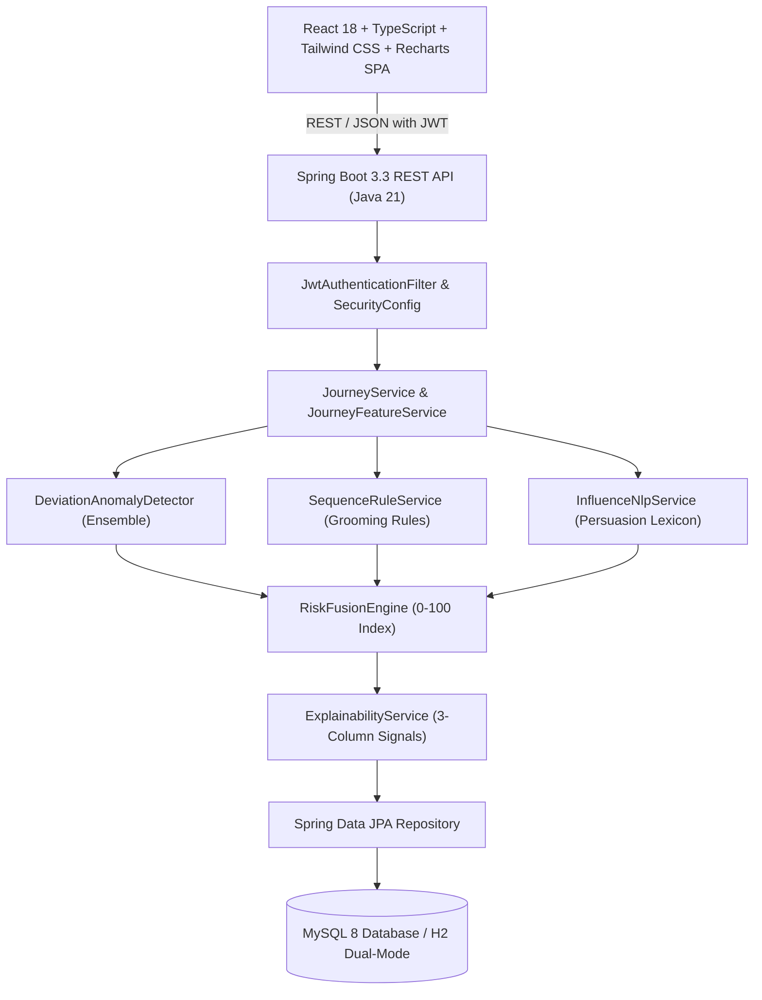

# Fingaurd AI — Behavioural Investment Safety & Pre-Commitment Risk Intelligence Platform

> **University Full Stack Java Mini Project**  
> **Course:** S.E. CSE-AIML, Semester III  
> **Tagline:** *Pause before you commit.*

---

## 1. Executive Summary & Problem Concept
Investment fraud in India is rarely one bad payment. It is a psychological journey: a modest first investment, an apparent quick return or payout, followed by progressively larger commitments until an outsized final trap. Existing fraud prevention systems only screen single payment gateways or emit generic advisory alerts.

**Fingaurd AI** fills the single highest-value gap: **just before a user executes a high-stake commitment**. By reconstructing the user's historical investment decision journey, comparing the proposed commitment against their personal baseline, and evaluating opt-in communication for coercive urgency, Fingaurd AI produces an explainable **Investment Manipulation Risk Index (0–100)** coupled with an interventionist **"Pause Before You Commit"** verification screen.

### Core Architecture Principles
1. **Journey-Level Analysis:** Evaluates sequences and step multipliers over time, not isolated transactions.
2. **Personal Baseline:** Risk is scored against the user's own historical distribution ($\mu$, $\sigma$, historical max), never an arbitrary average.
3. **Full Explainability:** 100% transparent. Sub-scores and signals decompose into *What changed*, *Why it matters*, and *What can I verify*.
4. **Consumer-Safety Safe Language Policy:** Never accuses individuals or issues legal fraud verdicts. Employs protective behavioural terminology: *"High-risk behavioural pattern detected"*, *"Manipulation indicators detected in communication"*, *"Pause and independently verify"*.
5. **Zero Bank / UPI Coupling:** Operates on manual logs, CSV statement imports, and synthetic presets. No banking credentials, OTPs, or financial secrets are ever stored.

---

## 2. Architecture & Monorepo Structure



```
fingaurd-ai/
├── backend/            Spring Boot 3, Java 21, Maven
│   ├── src/main/java/com/fingaurd/
│   │   ├── config/          SafetyLanguage, constants
│   │   ├── controller/      REST controllers (auth, investments, journey, risk, etc.)
│   │   ├── dto/             Request and response data transfer objects
│   │   ├── exception/       Global exception handler & structured error models
│   │   ├── model/           JPA entities (User, Investment, Journey, RiskReport, etc.)
│   │   ├── repository/      Spring Data JPA interfaces
│   │   ├── security/        JWT authentication filter & provider
│   │   ├── service/         Analytical engine & feature extractors
│   │   └── FingaurdApplication.java
│   ├── src/main/resources/  application.yml, application-mysql.yml
│   └── src/test/java/       Unit & Integration tests (Golden scenario, NLP, Security)
├── frontend/           React 18 + TS + Vite + Tailwind CSS + Recharts
│   ├── src/
│   │   ├── components/      Logo, RiskGauge, Navbar, Sidebar, ProtectedRoute, Layout
│   │   ├── context/         AuthContext
│   │   ├── pages/           Landing, Login, Dashboard, Investments, Journey, Analyse, Report, etc.
│   │   ├── services/        Axios API client with JWT interceptor
│   │   ├── types/           TypeScript interfaces
│   │   └── utils/           Indian currency (₹ lakh/crore) & risk band formatters
├── deploy/             Dockerfile.backend, Dockerfile.frontend, render.yaml, DEPLOYMENT.md
├── sample-data/        sample_investments.csv, sample_communication.txt
├── docker-compose.yml  One-command MySQL 8 + backend + frontend
└── README.md
```

---

## 3. Mathematical & Algorithmic Formulation

### 3.1 Personal Baseline & Escalation Metrics
From chronological investment sequence $\{A_1, A_2, \dots, A_N\}$:
$$\mu = \frac{1}{N} \sum_{i=1}^N A_i, \quad \sigma = \sqrt{\frac{1}{N}\sum_{i=1}^N (A_i - \mu)^2}$$
*(If $\sigma = 0$, fallback $z = 0$ prevents division by zero).*

For proposed commitment $P$:
- **Historical Max Ratio:** $P / \max(A_{\text{history}})$
- **Baseline Z-Score:** $(P - \mu) / \sigma$
- **Commitment Velocity:** $(P - A_{\text{first}}) / \max(1, \Delta\text{days})$ in ₹/day
- **Return-Followed-by-Escalation:** Boolean rule flagging commitments larger than prior steps following a `RETURNED` status or positive payout.

### 3.2 Anomaly Ensemble
$$\text{zScoreSignal} = \text{clamp}_{0,1}\left(\frac{|z| - 2.0}{3.0}\right)$$
$$\text{stepChangeSignal} = \text{clamp}_{0,1}\left(\frac{\max(\text{StepRatio}) - 2.0}{3.0}\right)$$
$$\text{maxRatioSignal} = \text{clamp}_{0,1}\left(\frac{\text{historicalMaxRatio} - 1.5}{3.5}\right)$$
$$\text{anomalyScore} = 0.4 \times \text{zScoreSignal} + 0.3 \times \text{stepChangeSignal} + 0.3 \times \text{maxRatioSignal}$$

### 3.3 Rule-Based NLP Influence Engine
Scans opt-in communication across 7 categories:
1. `URGENCY` ("limited slots", "last chance today", "closing in next")
2. `GUARANTEED_RETURNS` ("assured returns", "double your money", "100% safe return")
3. `PRESSURE_TO_INCREASE` ("deposit more", "upgrade your account", "scale up your capital")
4. `EXCLUSIVITY_FOMO` ("VIP group", "private club", "only 3 left")
5. `WITHDRAWAL_OR_UNLOCK_FEE` ("pay a small fee to release your withdrawal", "clearance charge")
6. `AUTHORITY_CLAIM` ("SEBI registered guru", "RBI accredited advisor")
7. `REPEATED_LARGER_PAYMENT_REQUEST` ("send another payment", "final payment required")

### 3.4 Risk Fusion Sub-Scores & Weight Redistribution
| Component | Maximum | Formula |
|---|---|---|
| **Financial Escalation** | 30 | $30 \times \text{clamp}_{0,1}((\text{maxRatio} - 1.0)/3.0) + \text{nudges (capped at 30)}$ |
| **Personal Baseline** | 25 | $25 \times \text{clamp}_{0,1}(|z| / 3.0)$ |
| **Commitment Velocity** | 20 | $20 \times \text{clamp}_{0,1}((\text{velocity} / A_{\text{first}}) / 0.7)$ |
| **Influence / Communication** | 25 | $25 \times (\text{highestConfidence} \times 0.6 + \text{categoryBlend} \times 0.4)$ |

**Redistribution Rule:** When communication analysis is omitted or unconsented, the other three components are scaled by $100 / 75$ so the index remains on a consistent 0–100 scale:
$$\text{Index}_{\text{redistributed}} = \min\left(100, \text{round}\left((\text{Escalation} + \text{Baseline} + \text{Velocity}) \times \frac{100}{75}\right)\right)$$

### 3.5 The Golden Scenario Benchmark
- **History:** ₹20,000 (returned ₹24,000) $\rightarrow$ ₹30,000 $\rightarrow$ ₹50,000 $\rightarrow$ ₹1,00,000 over 30 days.
- **Proposed:** ₹4,00,000 to Apex Wealth Advisory.
- **Calculated Features:**
  - Mean $\mu =$ ₹50,000, Population $\sigma \approx$ ₹30,800.
  - Historical Max Ratio $= 4.0\times$, Baseline $z$-score $\approx 11.4$.
  - Velocity $\approx$ ₹12,700/day.
  - Escalation $= 30/30$, Baseline $= 25/25$, Velocity $\approx 18/20$, Influence $= 0/25$ (communication enabled, no indicators).
  - **Index:** **73 / HIGH**.
- **Redistribution Case (No Communication):** $(30 + 25 + 18.1) \times (100 / 75) \approx \mathbf{97}$ (**CRITICAL**).
- **Urgent Pressure Text Added:** Index accelerates into **CRITICAL** ($\approx 95$).

---

## 4. REST API Reference

| Endpoint | Method | Purpose | Authentication |
|---|---|---|---|
| `/api/auth/register` | POST | Register new account (name, email, password) | Public |
| `/api/auth/login` | POST | Authenticate user & return JWT token | Public |
| `/api/auth/me` | GET | Retrieve authenticated user profile | Bearer JWT |
| `/api/demo/login` | POST | One-click instant login as demo user | Public |
| `/api/demo/seed` | POST | Load synthetic journey presets (Golden, Normal, etc.) | Bearer JWT |
| `/api/investments` | GET, POST | List user investments or log new event | Bearer JWT |
| `/api/investments/{id}` | PUT, DELETE | Update or remove investment event | Bearer JWT |
| `/api/investments/import` | POST | Multipart CSV upload with row-level error validation | Bearer JWT |
| `/api/users/{id}/journey` | GET | Reconstructed decision journey with annotated transition badges | Bearer JWT |
| `/api/risk/analyse` | POST | Execute pre-commitment risk evaluation | Bearer JWT |
| `/api/risk/{reportId}` | GET | Fetch persisted risk report with breakdown | Bearer JWT |
| `/api/risk/{reportId}/signals` | GET | Explainable signals grouped into What Changed / Why / Verify | Bearer JWT |
| `/api/risk/history` | GET | Historic reports for dashboard trend line | Bearer JWT |
| `/api/communications/analyse` | POST | Standalone NLP persuasion detection (consent required) | Bearer JWT |
| `/api/consent` | GET, POST | Inspect or update explicit user processing consent | Bearer JWT |
| `/api/audit` | GET | Immutable security and analysis event trail | Bearer JWT |

---

## 5. Local Setup & One-Command Run

### Prerequisites
- Java 21 JDK
- Apache Maven 3.9+
- Node.js 20+ & npm

### Method 1: Unified Docker Compose
```bash
docker compose up --build
```
- Frontend: `http://localhost:5173`
- Backend REST API: `http://localhost:8080`
- MySQL 8 Database: `localhost:3306`

### Method 2: Running Components on Windows (PowerShell)

#### 1. Backend (Spring Boot 3.3, Java 21):
```powershell
# Open Windows PowerShell in fingaurd-ai\backend:
cd backend

# If using the local portable tools:
$env:JAVA_HOME = "C:\Users\Lenovo i5\.gemini\antigravity\tools\jdk-21.0.5+11"
$env:M2_HOME = "C:\Users\Lenovo i5\.gemini\antigravity\tools\apache-maven-3.9.6"
$env:PATH = "$env:JAVA_HOME\bin;$env:M2_HOME\bin;$env:PATH"

# Run tests (12/12 passing):
mvn test

# Start the Spring Boot API:
mvn spring-boot:run
```
*(Backend starts on `http://localhost:8080`. Automatically seeds the demo account `demo@fingaurd.ai` / `Demo@1234` and pre-loads the Golden Scenario in embedded dual H2/MySQL mode).*

#### 2. Frontend (React 18 + TypeScript + Vite + Tailwind):
```powershell
# Open a second PowerShell window in fingaurd-ai\frontend:
cd frontend

# If using the local portable Node:
$env:PATH = "C:\Users\Lenovo i5\.gemini\antigravity\tools\node-v20.18.0-win-x64;$env:PATH"

# Install dependencies (first time only):
npm install

# Run frontend tests (3/3 passing):
npm test

# Launch Vite dev server:
npm run dev
```
*(Runs on `http://localhost:5173`. Proxies `/api/*` requests directly to backend port 8080).*

---

## 6. Three-Minute Presentation Demo Script

| Time | Screen | Action | Talking Points |
|---|---|---|---|
| **0:00 - 0:30** | **Landing Page** | Open `http://localhost:5173`. Play with the live risk gauge slider. Click **Try Interactive Demo**. | *"Investment scams in India aren't sudden one-off payments. Fraudsters groom victims over a multi-week journey. Fingaurd AI catches this pattern just before a large commitment."* |
| **0:30 - 1:00** | **Dashboard** | Highlight KPI cards, the semi-circular Risk Gauge, the cumulative exposure area chart, and donut concentration chart. | *"We are logged in as Rahul Sharma. Notice how the dashboard immediately displays our total historical exposure, our personal maximum, and our active risk index."* |
| **1:00 - 1:30** | **Journey Replay** | Navigate to **Journey Replay**. Point out the annotated badges (*"Apparent Return Received"*, *"2.0× previous commitment"*, *"rapid escalation"*). | *"Here is the reconstructed journey: ₹20k returned, followed by ₹30k, ₹50k, and ₹1,00,000. The system automatically tags behavioural grooming transitions."* |
| **1:30 - 2:00** | **Pre-Commitment Check** | Go to **Risk Analysis**. Type proposed amount `₹4,00,000`. Show the live helper badge: `4.0× historical max`. Click **Paste Sample Pressure Text** and submit. | *"Notice live feedback as we type ₹4,00,000. We paste a real WhatsApp message claiming a 'SEBI guru' and 'VIP group closing in 2 hours'. Let's run the pre-commitment check."* |
| **2:00 - 2:30** | **Risk Report & What Changed** | Review the 30/25/20/25 component bar breakdown and anomaly score. Click **What Changed?** to view the 3 columns. | *"The engine fuses Financial Escalation (30/30), Baseline Deviation (25/25), Velocity (18/20), and Urgency NLP. Signals are mapped to What changed, Why it matters, and What to verify."* |
| **2:30 - 3:00** | **Pause Screen** | Click **Pause Screen**. Show the full-screen calm intervention. Check items on the 7-point verification checklist (SEBI, MCA, RBI, 1930). Demonstrate that 'Proceed' is locked until acknowledgement. | *"This is our cognitive intervention: the user is forced into a calm space with official SEBI and RBI registries. The user makes the final choice, protected by evidence."* |

---

## 7. Responsible AI Governance & Limitations
- **Prototype Status:** This system is an academic proof-of-concept and has not undergone longitudinal clinical validation.
- **Not Financial or Legal Advice:** Outputs provide heuristic behavioral friction and should be confirmed against official regulatory portals (SEBI, RBI, MCA).
- **Privacy by Design:** Zero financial credentials, OTPs, or third-party bank access. Communication analysis is strictly opt-in and processed in ephemeral scope.
